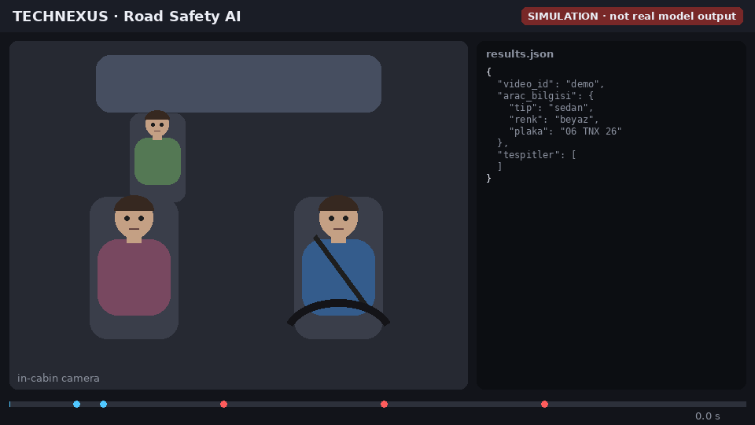

# TECHNEXUS: Road Safety AI

> 🚧 **In development.** This project was built for the Teknofest competition and I am still improving it.

TECHNEXUS watches in-car and dashcam video and reports what happens: who is driving, what the driver is doing, and which vehicle it is. The output is a JSON file in the competition's format.



*Simulated demo: an animation of the kind of detections the system makes and how they appear in `results.json`. It is not real model output. A demo on real footage is on the roadmap. The animation is generated by [`docs/make_demo.py`](docs/make_demo.py).*


## What it detects

**Driver actions** (in-cabin model)
- Yawning, smoking, drinking, talking on the phone
- Looking back, looking around, not wearing a seat belt
- Slalom (swerving) driving, from the vehicle's position over time

**Passengers and objects**
- Seat positions: front seat, rear left, rear right
- Objects in the cabin, such as a laptop or the competition's "Teknocan" toy

**Vehicle information** (detection model)
- Vehicle type: sedan, SUV, hatchback, pickup, minibus, panel van, truck
- Colour (9 colours)
- Licence plate, read with OCR and corrected to the Turkish plate format

## How it works

```
video ──► frame sampling (~6 fps) ──► image enhancement
              │
              ├─► YOLO11m  → vehicle type, colour, plate ──► EasyOCR
              │
              └─► YOLO11s  → 13 in-cabin classes
                     │
                     ├─ colour checks to tell smoking, drinking and phone use apart
                     ├─ head-position rules for looking back / around
                     ├─ passenger seat zones
                     └─ yawning and slalom detectors over time
                              │
                              ▼
                     results.json (vehicle info + timed detections)
```

- **Two models:** a larger YOLO11m for the vehicle and a faster YOLO11s for the cabin, both trained on our own labelled data.
- **Per-class thresholds** and a short cooldown so the same event is not reported many times.
- **Voting across frames** for vehicle type, colour and plate, so one bad frame does not change the result.

## Output example

```json
{
  "video_id": "video",
  "arac_bilgisi": { "...": "vehicle type, colour, plate" },
  "tespitler": [
    { "zaman_saniye": 4.2, "kategori": "sofor_eylemi", "etiket": "telefonla_konusma", "confidence_score": 0.71 }
  ]
}
```

## Project structure

```
main.py                  entry point: reads the video, writes results.json
src/predict.py           main pipeline
src/esneme_detector.py   yawning detection
src/slalom_detector.py   swerving detection
src/passenger_detector.py seat-zone classification
src/head_pose_detector.py head direction
src/ocr.py               licence-plate reading
src/utils.py             image enhancement, colour and plate helpers
Dockerfile               GPU image used for the competition
```

## Run

The trained weights are not included in this repository (see [`weights/`](weights/README.md)).

```bash
docker build -t technexus .
docker run --gpus all \
  -v $(pwd)/data/input:/app/data/input \
  -v $(pwd)/data/output:/app/data/output \
  technexus
```

Put the video at `data/input/video.mp4`. The result is written to `data/output/results.json`.

## Roadmap

- [ ] Publish a demo video with the detections drawn on it
- [ ] Improve accuracy on night and low-light footage
- [ ] Real-time mode for a live camera

## Team

Built as a team project for Teknofest.

---

Made by [Mariam Mahmoud](https://github.com/mar7233) · Computer Engineering, Bartın University
